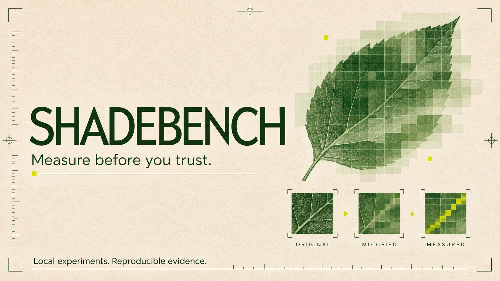

# Shadebench

**A small, local lab for image-perturbation experiments.**

Can a bounded pixel change move an image's feature representation? Does that change
survive saving, compression or resizing? Does it affect a model trained on the data?
Shadebench makes those questions inspectable instead of hiding them behind a
“protected” badge.

Inspired by the questions raised by [Nightshade](https://nightshade.cs.uchicago.edu/whatis.html).
**This is an educational fixed-feature experiment, not a Nightshade reproduction or
an artist-protection product.** No diffusion model is included or evaluated.

[Quick start](#run-it) · [Method](docs/method.md) · [Recorded results](docs/results.md) · [Limitations](docs/limitations.md)

## What actually runs

- Projected optimization toward a target representation, with a strict pixel cap.
- Clean, random-noise and optimized controls using the same source.
- PNG export followed by a check of the saved pixel bound.
- JPEG, resize and median-filter measurements on every arm.
- A synthetic retraining experiment with unchanged labels and held-out images.
- A standalone HTML report, JSON measurements and SHA-256 image hashes.

Everything runs locally on CPU. No model downloads, accounts, telemetry or external
API calls. Installation downloads Python packages; experiment execution is offline.
The cover is illustrative AI-generated artwork, not an experimental result.

## Run it

Python 3.9+ in a fresh environment:

```bash
git clone https://github.com/arhanali003/shadebench.git
cd shadebench
python3 -m venv .venv
source .venv/bin/activate     # Windows: .venv\Scripts\activate
python -m pip install --upgrade pip
python -m pip install .
shadebench --output runs/first --seed 0
```

Open `runs/first/index.html` in a browser. The report is self-contained and doesn't
load remote scripts. The output folder must be new: runs never overwrite earlier
results. A failed write can leave a partial folder; a successful CLI exit and both
report files are required for a complete run.

For an exact local dependency baseline, install `-c requirements-tested.txt .`.
Different NumPy/BLAS builds can produce small numeric differences; seeds do not
promise identical outputs on every platform.

### Try your own small images

```bash
shadebench --source source.png --target reference.png --output runs/custom --epsilon-pixels 8 --steps 80
```

Both images must be single-frame **32×32** files. Color is explicitly converted to
grayscale. Prepare copies yourself; the tool never silently resizes originals.
Custom images receive representation/transform measurements, not the synthetic
training experiment. Use images you own or have permission to process.

`--epsilon-pixels` accepts 0–32, `--steps` accepts 1–1000. The default is 8 pixel
levels and 80 iterations. These are experiment controls, not protection strengths.
Exit 0 means execution succeeded; it does not mean the perturbation was effective.
Exit 1 reports processing errors as JSON on stderr; argument errors use exit 2.

## Read the evidence

Every run exports `source.png`, `target.png`, `random.png`, `optimized.png`,
`report.json` and `index.html`. JSON includes environment versions, seed, parameters,
optimization history, image hashes, L-infinity distance, RMSE, PSNR, feature distances
and (for synthetic runs) per-class held-out accuracy.

An identical image has `psnr_db: null` and `identical: true`, avoiding nonstandard
JSON infinity. Original pixels and the saved optimized image are compared after
8-bit quantization. A low feature distance alone is not evidence of poisoning,
semantic confusion, visual invisibility or copyright protection.

## Development

```bash
python -m pip install -e .
python -m unittest discover -s tests -v
```

Tests cover a known analytic solution, optimization descent, pixel bounds, invalid
inputs, exact metrics, export round trips, deterministic replay, non-overwriting
behavior and CLI failures. CI runs on Linux, macOS and Windows with Python 3.9 and
3.13. See [Actions](https://github.com/arhanali003/shadebench/actions) for actual runs.

## Why this isn't called Nightshade

Nightshade studies prompt-specific poisoning of text-to-image diffusion models.
Our small linear encoder and ridge classifier cannot establish those results.
Reproducing the paper would require licensed model weights, an appropriate image
corpus, diffusion training, multiple seeds and independent evaluation. That work
is **not implemented** here.

The project was developed with AI assistance. Code, tests and documentation are
available for inspection; no independent human peer review or university affiliation
is claimed. See [research notes](docs/method.md), [contributing](CONTRIBUTING.md) and
[MIT license](LICENSE). No Nightshade application code or sample artwork is bundled.
