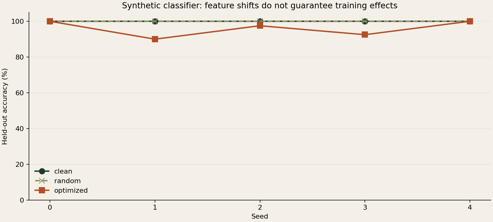

# Recorded experiments

Five seeded runs, seeds 0–4, with the default 8/255 pixel cap and 80 steps. Python
3.9.6, NumPy 1.26.4, Pillow 11.3.0, Apple Silicon CPU. These are synthetic experiments,
not tests of any image generator. All five runs are included without seed selection.

| Seed | Initial target distance | Optimized distance | Clean accuracy | Random accuracy | Optimized accuracy |
| --- | ---: | ---: | ---: | ---: | ---: |
| 0 | 0.9508 | 0.1610 | 100% | 100% | 100% |
| 1 | 0.8472 | 0.0461 | 100% | 100% | 90% |
| 2 | 0.7262 | 0.0056 | 100% | 100% | 97.5% |
| 3 | 0.5736 | 0.0057 | 100% | 100% | 92.5% |
| 4 | 0.6336 | 0.0053 | 100% | 100% | 100% |

Feature distance is for each run's example image. Accuracy is for a separate
synthetic train/test experiment within that run. They are different measurements.
Each accuracy denominator is 80 held-out synthetic images; do not interpret these
small samples as real-world rates. See report.json for per-class outcomes.



The important result is mixed: feature distance fell in every run, while held-out
accuracy changed in only three runs. Effects were not uniformly on the source
class. This does not reproduce Nightshade's prompt-specific behavior. Small
feature-space distance is insufficient evidence for a reliable training effect.

Raw aggregate: [results.json](../examples/results.json). Complete reports and
images live under `examples/seed-0` through `examples/seed-4`. Download/open an
`index.html` locally for a self-contained visual report; GitHub shows its source.

Reproduce a seed in a **new** output folder:

```bash
shadebench --output runs/reproduce-0 --seed 0 --epsilon-pixels 8 --steps 80
```

Twelve local unit/integration tests pass. The GitHub Actions matrix provides
separate platform validation; check its actual status rather than assuming it
passed from the workflow's existence. These tests verify implementation properties,
not artist protection or universal model poisoning.
